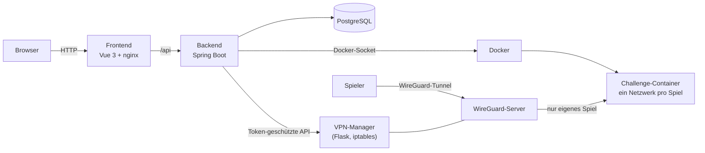

# 👾 Hack & Seek

**Attack-Defense-CTF-Plattform**


## Worum geht's?

Bei Hack & Seek bekommt jedes Team einen identischen, absichtlich verwundbaren
Container. Ziel ist es, die Schwachstellen der gegnerischen Container zu finden
und deren Flags zu erbeuten – und gleichzeitig den eigenen Container
abzusichern. Patchen ist erwünscht, das bloße Schließen von Ports oder ein
kaputter Dienst wird bestraft. Jedes Spiel läuft in einem eigenen, über
WireGuard isolierten Netzwerk: Spieler erreichen nur die Container des Spiels,
in dem sie gerade sind.

<!-- Screenshot folgt: docs/images/ -->

## Features

- **Spiele erstellen und starten** – Challenge auswählen, Teams bilden und
  Freunde zuteilen; beim Start bekommt jedes Team seinen eigenen Container mit
  generierter Flag und eigenem Root-Passwort.
- **Isolation pro Spiel** – eigenes Docker-Netzwerk (`10.200.x.0/24`) und
  eigene Firewall-Regeln pro Spiel, Zugang nur über den persönlichen
  WireGuard-Tunnel.
- **VPN-Konfiguration auf Knopfdruck** – jeder Spieler lädt seine
  WireGuard-Config direkt im Browser herunter.
- **Punkte und Scoreboard** – eine erbeutete Flag bringt die Punkte der
  Challenge, das gegnerische Team scheidet aus; das letzte verbleibende Team
  gewinnt.
- **Automatisches Monitoring** – alle 30 Sekunden werden Flag-Integrität,
  Erreichbarkeit des Dienstes und das Healthcheck-Skript jeder Challenge
  geprüft; wer den Dienst kaputt macht, wird disqualifiziert (−50 Punkte).
- **Selbstheilendes VPN** – nach einem Neustart des WireGuard-Containers stellt
  das Backend Peers, Routen und Firewall-Regeln aller laufenden Spiele
  automatisch wieder her.
- **Freunde** – Freundschaftsanfragen, Freundesliste und ein Scoreboard mit
  den eigenen Freunden.

## Architektur



Der Browser spricht nur mit dem Frontend; nginx leitet `/api/` an das Backend
weiter, das selbst nicht nach außen veröffentlicht ist. Das Backend steuert
Docker direkt und lässt den VPN-Manager im WireGuard-Container die
Firewall-Regeln setzen, die jeden Spieler auf das Netzwerk seines Spiels
beschränken. Details: [docs/architektur.md](docs/architektur.md).

## Challenges

| Challenge | Beschreibung | Schwierigkeit | Punkte |
|---|---|---|---|
| `ping-me` | Netzwerk-Diagnose-Webseite | 1 | 100 |
| `note-keeper` | Notiz-App | 1 | 100 |
| `leaky-blog` | Persönlicher Blog | 1 | 100 |

Jede Challenge ist ein Docker-Image mit Webdienst (Port 80) und SSH (Port 22).
Eigene Challenges lassen sich über Docker-Labels hinzufügen:
[docs/challenges.md](docs/challenges.md).

## Schnellstart

**Voraussetzungen:** Linux-Host mit Docker und Docker Compose (WireGuard
braucht das Kernel-Modul des Hosts).

1. Konfiguration anlegen:

   ```bash
   cp env-example .env
   ```

2. In `.env` **alle** Platzhalter in eckigen Klammern ersetzen:

   | Variable | Bedeutung |
   |---|---|
   | `PASSWORD` | Passwort der Datenbank |
   | `VPN_MANAGER_TOKEN` | gemeinsames Geheimnis von Backend und VPN-Manager, z. B. `openssl rand -hex 32` |
   | `VPN_SERVER_ENDPOINT` | Adresse, mit der sich die Spieler verbinden, als `host:port`; der Port muss `WIREGUARD_PORT` entsprechen |
   | `FRONTEND_PORT`, `WIREGUARD_PORT`, `ADMINER_PORT` | Ports, Standard `80`, `51820`, `8081` |

   ⚠️ Das Datenbank-Passwort darf nicht zu einfach sein (z. B. `1234`), sonst
   startet der Container je nach Version nicht. Die gewählten Ports dürfen
   nicht schon belegt sein.

3. Challenge-Images bauen (Compose baut sie nicht mit):

   ```bash
   for c in ping-me note-keeper leaky-blog; do docker build -t "$c" "images/$c"; done
   ```

4. Starten:

   ```bash
   docker compose up -d --build
   ```

   Die Plattform ist dann unter `http://<host>:<FRONTEND_PORT>` erreichbar.

5. Stoppen: `docker compose down`. Die Daten bleiben erhalten;
   `docker compose down -v` löscht auch die Datenbank.

Nach außen offen sind nur das Frontend und der WireGuard-Port. Adminer
(`127.0.0.1:8081`) und PostgreSQL (`127.0.0.1:5432`) hören nur auf localhost.

## Spielablauf

1. **Registrieren** und einloggen.
2. **VPN-Config herunterladen** und in WireGuard importieren.
3. **Freunde hinzufügen** – der Ersteller eines Spiels teilt seine Freunde
   den Teams zu und startet das Spiel.
4. **Angreifen und verteidigen:** den eigenen Container per SSH absichern, die
   gegnerischen Container über das VPN angreifen.
5. **Flags einreichen** – wer zuletzt übrig bleibt, gewinnt.

Ausführlich: [docs/spielablauf.md](docs/spielablauf.md).

## Entwicklung und Tests

```bash
# Backend lokal: Datenbank in Docker, Backend auf dem Host
docker compose up database -d
cd has-backend && cp env-example .env   # Passwort eintragen
./gradlew bootRun

# Tests
cd has-backend && ./gradlew test        # 143 Tests, H2 in-memory
pytest has-vpn                          # 39 Tests für den VPN-Manager
cd has-frontend && npm run cy:run       # Cypress-E2E, API gestubbt
```

Mehr dazu: [docs/entwicklung.md](docs/entwicklung.md).

## Projektstruktur

| Pfad | Inhalt |
|---|---|
| `has-backend/` | Spring Boot 3.5, Java 21 – REST-API, Spiellogik, Docker-Steuerung |
| `has-frontend/` | Vue 3, Pinia, Tailwind CSS 4, Vite – Weboberfläche, Cypress-Tests |
| `has-vpn/` | WireGuard-Server und VPN-Manager (Flask) für die Firewall-Regeln |
| `images/` | Challenge-Images `ping-me`, `note-keeper`, `leaky-blog` |
| `docs/` | technische Dokumentation |

## Bekannte Einschränkungen

Bewusste Kompromisse für den Einsatz im Schulumfeld:

- Die WireGuard-Schlüssel der Spieler werden serverseitig erzeugt und in der
  Datenbank gespeichert – bequem für die Spieler, aber ein Datenbank-Leak
  würde alle Tunnel-Zugänge offenlegen.
- Die Vergabe von VPN-IPs und Spiel-Subnetzen ist nicht gegen gleichzeitige
  Anfragen abgesichert; bei Schulgröße kein Problem.
- Beim Start des WireGuard-Containers ist das Forwarding für etwa eine Sekunde
  offen, bis der VPN-Manager die Firewall initialisiert.

Vollständige Liste: [docs/bekannte-einschraenkungen.md](docs/bekannte-einschraenkungen.md).

## Team

| Name | Aufgabe |
|---|---|
| Christian Parushev | Projektleiter, Vue-Frontend |
| Andreas Maurer | VPN (WireGuard) |
| Florian Andrä | Container-Orchestrierung |
| Yunus Eren | Spring-Backend |
| Felix Bayerl | Datenbank |

<sub>Entstanden als Diplomarbeit am TGM.</sub>

## Lizenz

Folgt.
