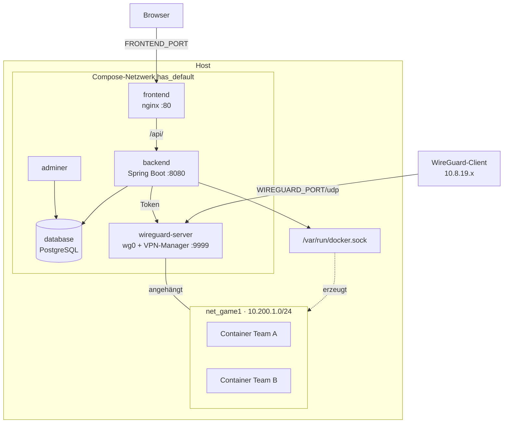
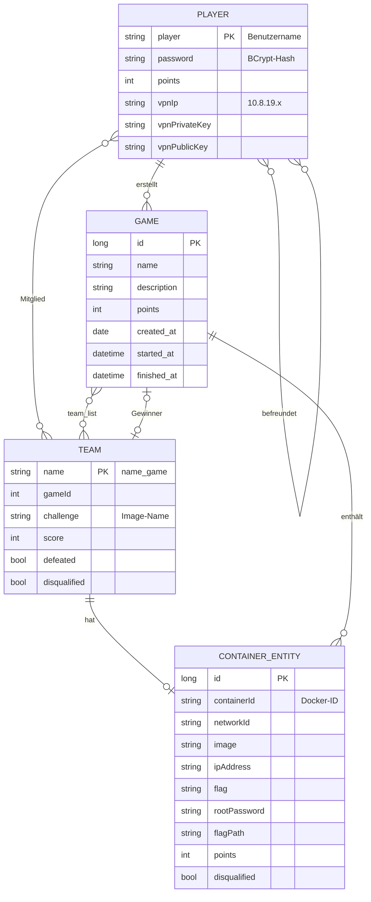

# Architektur

Überblick über die Dienste von Hack & Seek, wie sie zusammenspielen und wie
Backend und Frontend aufgebaut sind. Den Ablauf eines Spiels beschreibt
[spielablauf.md](spielablauf.md), das VPN [vpn-und-isolation.md](vpn-und-isolation.md).

## Dienste

Alle Dienste werden über `docker-compose.yml` gestartet.

| Dienst | Image / Build | Aufgabe | Von außen erreichbar |
|---|---|---|---|
| `frontend` | `has-frontend/` (Vite-Build, nginx) | liefert die Vue-App aus, leitet `/api/` an das Backend weiter | ja, `FRONTEND_PORT` (Standard 80) |
| `backend` | `has-backend/` (Spring Boot) | REST-API, Spiellogik, steuert Docker über `/var/run/docker.sock` | nein |
| `database` | `postgres:15-alpine` | Datenbank `has`, Daten im Volume `has-db-data` | nur `127.0.0.1:5432` |
| `adminer` | `adminer` | Datenbank-Oberfläche für Admins | nur `127.0.0.1:ADMINER_PORT` (Standard 8081) |
| `wireguard-server` | `has-vpn/` (linuxserver/wireguard + VPN-Manager) | WireGuard-Server für die Spieler, VPN-Manager auf Port 9999 | nur `WIREGUARD_PORT`/udp (Standard 51820); Port 9999 nicht |

Dazu kommen zur Laufzeit pro Spiel ein Docker-Netzwerk `net_game<id>` und ein
Challenge-Container pro Team. Diese erzeugt das Backend selbst, nicht Compose.

### Wer mit wem spricht

- **Browser → Frontend:** Der Browser lädt die Vue-App und schickt alle
  API-Aufrufe an denselben Host. nginx leitet `/api/` an `backend:8080` weiter;
  das Backend ist dadurch nie direkt erreichbar, und es gibt keine
  CORS-Probleme.
- **Backend → Datenbank:** JPA/Hibernate über
  `jdbc:postgresql://database:5432/has`. Das Schema erzeugt Hibernate selbst
  (`ddl-auto=update`).
- **Backend → Docker:** über den gemounteten Docker-Socket (docker-java).
  Damit erstellt das Backend Spiel-Netzwerke und Challenge-Container, liest
  Image-Labels und führt Befehle in Containern aus, zum Beispiel `wg` im
  WireGuard-Container oder `healthcheck.sh` in den Challenges.
- **Backend → VPN-Manager:** HTTP an `wireguard-server:9999`, abgesichert mit
  dem gemeinsamen `VPN_MANAGER_TOKEN`. Der Manager setzt die
  iptables-Regeln, die festlegen, welcher Spieler welches Spiel-Netzwerk
  erreicht.
- **Spieler → Challenges:** über den WireGuard-Tunnel. Der WireGuard-Container
  ist an jedes laufende Spiel-Netzwerk angehängt und leitet nur weiter, was
  die Firewall-Regeln erlauben.

## Backend

Spring Boot 3.5.6, Java 21, Gradle. Paket `Diplo10`:

| Paket | Inhalt |
|---|---|
| `controller` | REST-Controller (`/api/...`), nehmen Requests entgegen und geben DTOs zurück |
| `dto` | Antwortobjekte (`GameView`, `TeamView`, `PlayerSummary`, `ChallengeDTO`, `DefeatLogEntry`) |
| `service` | Spiellogik: `GameService`, `FlagService`, `PlayerService`, `FriendService`, `FriendrequestService`, `ScoreboardService` |
| `service.orchestration` | Docker: `OrchestrationService`, `ContainerService`, `NetworkService`, `ImageService`, `MonitoringService` |
| `service.vpn` | `VpnService` (Schlüssel, Peers, Configs), `VpnManagerClient` (HTTP zum Manager), `VpnResyncService` |
| `entity` | JPA-Entities |
| `repository` | Spring-Data-Repositories |
| `exception` | eigene Exceptions und `GlobalExceptionHandler` |
| `config` | Security, Docker-Client, Web-Konfiguration |

Die Schichten sind klassisch: Controller → Service → Repository. Controller
geben nie Entities zurück, sondern immer DTOs, damit keine internen Felder
nach außen gelangen. Felder mit Geheimnissen (Passwort-Hash, VPN-Schlüssel,
Flag, Root-Passwort) sind zusätzlich mit `@JsonIgnore` markiert.

### Geplante Aufgaben

| Dienst | Intervall | Aufgabe |
|---|---|---|
| `MonitoringService` | alle 30 s | prüft jeden Challenge-Container laufender Spiele (siehe [spielablauf.md](spielablauf.md#monitoring)) |
| `VpnResyncService` | alle 15 s | erkennt einen Neustart des WireGuard-Containers und stellt das VPN wieder her (siehe [vpn-und-isolation.md](vpn-und-isolation.md#wiederherstellung-nach-einem-neustart)) |

### Sicherheit

- **Login:** Formular-POST an `/api/auth/login` (Spring Security
  `formLogin`), Logout über `/api/auth/logout`. Passwörter werden mit BCrypt
  gehasht.
- **Session:** Cookie, `HttpOnly`, `SameSite=Lax`, gültig 7 Tage. Die
  Sessions liegen im Speicher des Backends; nach einem Neustart des Backends
  müssen sich alle neu einloggen.
- **Zugriff:** Alles außer `/api/auth/**` braucht eine Session. Ohne Session
  antwortet das Backend mit `401` statt mit einer Weiterleitung, weil es eine
  reine JSON-API ist.
- **CSRF** ist deaktiviert.
- **Prüfung des Aufrufers:** Die Endpunkte arbeiten immer als der eingeloggte
  Benutzer; es gibt keine Parameter, mit denen man im Namen eines anderen
  handeln könnte. Wer bei Spielen was darf, steht in
  [spielablauf.md](spielablauf.md#berechtigungen).

### Fehlerbehandlung

`GlobalExceptionHandler` übersetzt Exceptions in HTTP-Statuscodes:

| Exception | Status |
|---|---|
| `NotFoundException` | 404 |
| `IllegalArgumentException`, `IllegalStateException` | 400 |
| `VpnUnavailableException` (WireGuard nicht erreichbar) | 503 |

### API-Überblick

| Bereich | Endpunkte |
|---|---|
| `/api/auth` | `POST /register`, `POST /login`, `POST /logout`, `GET /me` |
| `/api/user` | `GET /?username=` (Punkte eines Spielers), `GET /me`, `GET /me/vpn-config` |
| `/api/games` | `GET /challenges`, `POST /create`, `GET /`, `GET /{id}`, `POST /{id}/start`, `POST /{id}/stop`, `POST /{id}/submit-flag`, `GET /{id}/defeat-log`, `POST /{id}/dismiss`, `GET /{id}/credentials` |
| `/api/friend` | `POST /` (Anfrage senden), `GET /requests`, `POST /acceptRequest`, `POST /refuseRequest`, `GET /friends`, `DELETE /?friend=` (Freund entfernen) |
| `/api/scoreboard` | `GET /` (eigene Freunde und man selbst) |

## Datenmodell

Dazu kommen drei Tabellen ohne Fremdschlüssel, die nur über die Spiel-ID und
Teamnamen verknüpft sind:

| Tabelle | Inhalt |
|---|---|
| `friendrequest` | offene Freundschaftsanfragen (`requester`, `receiver`) |
| `flag_submission` | jede erfolgreiche Flag-Abgabe: angreifendes und besiegtes Team, Punkte, Zeit; daraus entsteht das Defeat-Log |
| `sla_event` | Ergebnis jeder Monitoring-Prüfung: Team, Container, Art der Prüfung, bestanden ja/nein |

Ein Team gehört immer zu genau einem Spiel; sein Name enthält deshalb die
Spiel-ID (`<name>_game<id>`), damit gleich benannte Teams verschiedener
Spiele nicht kollidieren.

## Frontend

Vue 3 mit Vite, Pinia, Vue Router, Tailwind CSS 4 und axios.

| Ordner | Inhalt |
|---|---|
| `views/` | Seiten: `HomeView`, `LoginView`, `RegisterView`, `DashboardView`, `GameDetailView` |
| `components/` | `Game`, `CreateGameModal`, `Scoreboard`, `Friends`, `AddFriends`, `FriendRequests`, `VpnManagement`, Navigationsleisten |
| `services/` | ein Modul pro API-Bereich (`GameService`, `UserService`, `FriendService`, `ScoreboardService`, `VpnService`) |
| `stores/auth.js` | Pinia-Store für den Login-Zustand |
| `router/` | Routen und Guards |

| Route | Seite | Zugriff |
|---|---|---|
| `/` | Startseite | eingeloggte Benutzer werden zum Dashboard weitergeleitet |
| `/login`, `/register` | Login, Registrierung | öffentlich |
| `/dashboard` | Spiele, Freunde, Scoreboard, VPN | nur eingeloggt |
| `/game/:id` | Spielansicht mit Teams, Zugangsdaten, Flag-Abgabe, Defeat-Log | nur eingeloggt |

Der Router-Guard fragt vor geschützten Seiten über den Auth-Store beim Backend
nach, ob die Session noch gültig ist, und leitet sonst zu `/login` weiter.
axios schickt das Session-Cookie bei jedem Aufruf mit
(`withCredentials`).

Die Cypress-Tests in `has-frontend/cypress/` ersetzen die API mit
`cy.intercept`, laufen also ohne Backend (siehe [entwicklung.md](entwicklung.md)).
