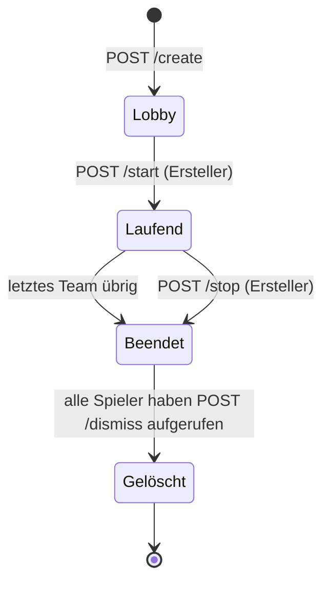
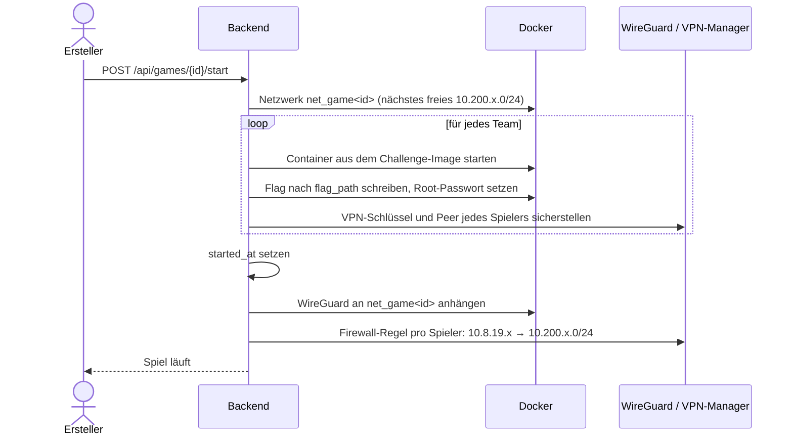

# Spielablauf

Wie ein Spiel von der Erstellung bis zum Ende abläuft, wie Punkte vergeben
werden und wer was darf. Den Aufbau der Dienste beschreibt
[architektur.md](architektur.md), das VPN [vpn-und-isolation.md](vpn-und-isolation.md).

## Überblick

| Zustand | Erkennbar an | Was existiert |
|---|---|---|
| Lobby | `started_at` leer | Spiel und Teams in der Datenbank |
| Laufend | `started_at` gesetzt, `finished_at` leer | zusätzlich Netzwerk, Container, VPN-Regeln |
| Beendet | `finished_at` gesetzt | nur noch die Datenbank-Einträge mit Ergebnis |

## 1. Erstellen

`POST /api/games/create` mit Name und einer Liste von Teams. Jedes Team hat
einen Namen, eine Liste von Spielern und eine Challenge. In der Oberfläche
wählt der Ersteller dafür aus seinen Freunden aus (er selbst steht ebenfalls
zur Auswahl).

- Die Challenge muss eines der angebotenen Challenge-Images sein (Label
  `type=challenge`). Andernfalls würde ein beliebiges Image vom Host gestartet,
  deshalb lehnt das Backend unbekannte Namen mit `400` ab.
- Teams werden als `<name>_game<id>` gespeichert, damit gleich benannte Teams
  verschiedener Spiele nicht kollidieren.
- Der Ersteller wird als `created_by` gespeichert.

## 2. Starten

`POST /api/games/{id}/start`, nur durch den Ersteller und nur, wenn das Spiel
noch nicht gestartet wurde und Teams hat. Der Start ist **alles oder nichts**:
ein Spiel ist nur fair, wenn jedes Team seinen Container hat. Schlägt ein
Schritt fehl, räumt das Backend die schon erstellten Container wieder ab, und
das Spiel bleibt in der Lobby.

Jeder Challenge-Container bekommt:

| Was | Wert |
|---|---|
| Flag | `HAS{` + 32 zufällige Hex-Zeichen + `}`, geschrieben nach dem `flag_path`-Label des Images |
| Root-Passwort | 24 zufällige Zeichen (`SecureRandom`), gesetzt per `chpasswd` |
| Punkte | aus dem `points`-Label, Standard 100 |
| Ressourcen | 128 MB RAM, 0,5 CPU, Neustart-Policy `unless-stopped` |
| Netzwerk | nur das Netzwerk des Spiels |

Die Spieler sehen in der Spielansicht die IP-Adressen aller Team-Container und
holen über `GET /api/games/{id}/credentials` Root-Passwort und IP ihres
**eigenen** Containers.

## 3. Spielen

- **Verteidigen:** Die Spieler melden sich per SSH als `root` an ihrem eigenen
  Container an und schließen die Schwachstellen. Der Dienst muss dabei
  weiterlaufen, sonst greift das Monitoring.
- **Angreifen:** Über den WireGuard-Tunnel erreichen sie die Container der
  anderen Teams desselben Spiels (Webdienst auf Port 80, SSH auf Port 22) und
  suchen deren Flag.
- **Flag abgeben:** `POST /api/games/{id}/submit-flag` mit `{"flag": "HAS{...}"}`.

### Punkte

Eine Flag-Abgabe wird abgelehnt, wenn

- das Spiel schon beendet ist,
- der Spieler in keinem Team dieses Spiels ist,
- sein Team bereits besiegt ist,
- die Flag zu keinem Container des Spiels passt,
- es die Flag des eigenen Teams ist,
- diese Flag schon erbeutet wurde.

Bei einer gültigen Abgabe

1. wird sie in `flag_submission` gespeichert (daraus entsteht das Defeat-Log,
   `GET /api/games/{id}/defeat-log`),
2. bekommen das angreifende Team und **jeder seiner Spieler** die Punkte der
   Challenge,
3. ist das gegnerische Team besiegt; sein Container wird gestoppt und entfernt,
4. endet das Spiel, wenn nur noch ein Team übrig ist; dieses Team gewinnt.

Die Spielerpunkte sind spielübergreifend und erscheinen im Scoreboard.

## Monitoring

`MonitoringService` prüft **alle 30 Sekunden** jeden Container laufender
Spiele, der nicht schon disqualifiziert ist. Die Prüfungen laufen mit
`docker exec` im Container selbst, jeweils mit 5 Sekunden Timeout:

| # | Prüfung | Bestanden, wenn |
|---|---|---|
| 1 | Flag-Integrität | `cat <flag_path>` genau die vergebene Flag liefert |
| 2 | Dienst erreichbar | `curl http://localhost:80/` einen Statuscode 200–399 liefert |
| 3 | Funktion | `/healthcheck.sh` der Challenge mit Exit-Code 0 endet |

Jedes Ergebnis wird in `sla_event` gespeichert. Die erste fehlgeschlagene
Prüfung **disqualifiziert** das Team:

- −50 Punkte für das Team und für jeden seiner Spieler,
- das Team gilt als besiegt, sein Container wird entfernt,
- ist danach nur noch ein Team übrig, endet das Spiel mit diesem Sieger.

Damit wird bestraft, was Attack-Defense verbietet: die Flag löschen, den
Dienst abschalten oder ihn so „patchen“, dass er nicht mehr funktioniert.
Was `healthcheck.sh` prüft, beschreibt [challenges.md](challenges.md).

> **Einschränkung:** Weil die Prüfungen im Container laufen, in dem das Team
> Root-Rechte hat, könnte ein Team `curl` oder `healthcheck.sh` durch
> Versionen ersetzen, die immer Erfolg melden, und den Dienst danach
> abschalten. Siehe
> [bekannte-einschraenkungen.md](bekannte-einschraenkungen.md#das-monitoring-läuft-im-container-des-teams).

## 4. Beenden

Ein Spiel endet auf zwei Wegen:

- **automatisch**, wenn durch eine Flag oder eine Disqualifikation nur noch
  ein Team übrig ist;
- **manuell** über `POST /api/games/{id}/stop` durch den Ersteller. Sieger ist
  dann das nicht besiegte Team mit den meisten Punkten; bei Gleichstand gibt
  es keinen Sieger.

Beim Beenden setzt das Backend `finished_at` und den Sieger und baut das Spiel
in dieser Reihenfolge ab:

1. Firewall-Regeln der Spieler entfernen (bestmöglich: ist der VPN-Manager
   gerade nicht erreichbar, geht der Abbau trotzdem weiter, denn der Manager
   löscht beim Neustart ohnehin alle Regeln),
2. WireGuard vom Spiel-Netzwerk trennen,
3. Container und Netzwerk löschen.

Die Reihenfolge ist wichtig: Docker löscht kein Netzwerk, an dem WireGuard
noch hängt.

## 5. Verlassen und Löschen

`POST /api/games/{id}/dismiss` entfernt den aufrufenden Spieler aus einem
**beendeten** Spiel, zum Beispiel um es aus der eigenen Liste zu entfernen.

- Verlässt der Ersteller das Spiel, übernimmt ein verbleibender Spieler die
  Rolle.
- Ist niemand mehr übrig, wird das Spiel gelöscht.

## Berechtigungen

| Aktion | Endpunkt | Wer |
|---|---|---|
| Spiel erstellen | `POST /create` | jeder eingeloggte Benutzer |
| eigene Spiele auflisten | `GET /` | jeder, sieht nur Spiele, die er erstellt hat oder in denen er mitspielt |
| Spiel ansehen | `GET /{id}` | Ersteller und Spieler des Spiels |
| starten, stoppen | `POST /{id}/start`, `/stop` | nur der Ersteller |
| Flag abgeben | `POST /{id}/submit-flag` | Ersteller und Spieler; Punkte gibt es nur für Spieler in einem Team |
| Defeat-Log | `GET /{id}/defeat-log` | nur Spieler des Spiels |
| Zugangsdaten | `GET /{id}/credentials` | nur Spieler, nur für den eigenen Container |
| Spiel verlassen | `POST /{id}/dismiss` | Ersteller und Spieler, nur bei beendeten Spielen |

Andere Benutzer bekommen `403`, unbekannte Spiele `404`. Die Spiel-Antworten
enthalten nie Flags oder Root-Passwörter.
