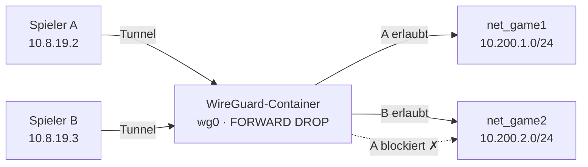

# VPN und Isolation

Wie Spieler über WireGuard zu den Challenge-Containern kommen und warum sie
dabei nur die Container ihres eigenen Spiels erreichen. Den Ablauf eines
Spiels beschreibt [spielablauf.md](spielablauf.md).

## Grundidee

Isolation entsteht auf zwei Ebenen:

1. **Docker:** Jedes Spiel hat ein eigenes Bridge-Netzwerk `net_game<id>`.
   Container verschiedener Spiele können sich nicht erreichen.
2. **Firewall im WireGuard-Container:** Der WireGuard-Container hängt an allen
   laufenden Spiel-Netzwerken und könnte damit überall hin routen. Die
   `FORWARD`-Kette steht deshalb auf `DROP`, und der VPN-Manager erlaubt pro
   Spieler genau das Subnetz seines Spiels.



## Adressen

| Bereich | Verwendung |
|---|---|
| `10.8.19.0/24` | WireGuard-Netz. `10.8.19.1` ist der Server, jeder Spieler bekommt dauerhaft eine eigene Adresse ab `10.8.19.2`. |
| `10.200.0.0/16` | Spiel-Netzwerke, je ein `/24` pro Spiel (`10.200.1.0/24`, `10.200.2.0/24`, …). |

Die Spieler-Config routet genau diese beiden Bereiche durch den Tunnel
(`AllowedIPs = 10.8.19.0/24, 10.200.0.0/16`); der restliche Verkehr des
Spielers bleibt außerhalb des VPN.

## Schlüssel

WireGuard arbeitet mit Schlüsselpaaren. Der öffentliche Schlüssel wird aus dem
privaten berechnet; geheim ist nur der private.

- **Jede Seite hat ihr eigenes Paar:** der Server eines, jeder Spieler eines.
- **Die Spieler-Config** enthält den privaten Schlüssel des Spielers und den
  öffentlichen Schlüssel des **Servers**. Der Server-Schlüssel ist also in
  allen Configs gleich und weist den Server gegenüber dem Spieler aus.
- **Der Server** kennt seinen eigenen privaten Schlüssel und die öffentlichen
  Schlüssel aller Spieler. Jeder Spieler-Schlüssel ist mit
  `allowed-ips 10.8.19.x/32` an genau eine Adresse gebunden. Darauf verlassen
  sich die Firewall-Regeln: Eine Quelladresse im Tunnel gehört sicher zu
  genau einem Spieler.
- Beide Seiten berechnen aus dem eigenen privaten und dem fremden öffentlichen
  Schlüssel (Diffie-Hellman) dasselbe gemeinsame Geheimnis. Jeder
  Spieler-Tunnel hat so ein anderes.

### Woher die Schlüssel kommen

| Schlüssel | Erzeugt | Gespeichert |
|---|---|---|
| Server | vom WireGuard-Image beim ersten Start | `config/server/` auf dem Host (nicht im Repository) |
| Spieler | vom Backend mit `wg genkey` im WireGuard-Container | Tabelle `player` (`vpn_private_key`, `vpn_public_key`) |

Den öffentlichen Server-Schlüssel liest das Backend bei jeder Config direkt aus
dem laufenden Interface (`wg show wg0 public-key`); es muss also nichts
konfiguriert werden. Läuft WireGuard nicht, antwortet das Backend mit `503`
statt eine unbrauchbare Config auszuliefern.

Wird `config/server/` gelöscht, erzeugt das Image beim nächsten Start ein neues
Server-Schlüsselpaar, und alle Spieler müssen ihre Config neu herunterladen.

### Wann ein Spieler eingetragen wird

`VpnService.ensureVpnConfig` vergibt bei Bedarf Adresse und Schlüsselpaar und
trägt den Spieler als Peer ein (`wg set wg0 peer … allowed-ips 10.8.19.x/32`
plus Route über `wg0`). Das passiert:

- bei der Registrierung,
- beim Abruf von `GET /api/user/me` und beim Download der Config,
- beim Start jedes Spiels für alle Spieler,
- bei der Wiederherstellung nach einem Neustart (siehe unten).

Der Aufruf ist idempotent und kann beliebig oft passieren.

### Config herunterladen

`GET /api/user/me/vpn-config` liefert die fertige Config des **eingeloggten**
Spielers; ein Parameter für andere Benutzer existiert nicht.

```ini
[Interface]
PrivateKey = <privater Schlüssel des Spielers>
Address = 10.8.19.x/32

[Peer]
PublicKey = <öffentlicher Schlüssel des Servers>
Endpoint = <VPN_SERVER_ENDPOINT>
AllowedIPs = 10.8.19.0/24, 10.200.0.0/16
PersistentKeepalive = 25
```

## VPN-Manager

Ein kleiner Flask-Dienst (`has-vpn/vpn-manager.py`), der im WireGuard-Container
läuft und dessen iptables-Regeln setzt. Er hört auf Port 9999, der nicht
veröffentlicht ist; nur das Backend ruft ihn über das Compose-Netzwerk auf.

| Endpunkt | Aufgabe |
|---|---|
| `GET /health` | Status und die `instance`-ID dieses Laufs (ohne Token) |
| `POST /api/game/player` | `{playerIp, subnet}`: Spieler darf das Subnetz erreichen |
| `DELETE /api/game/player` | `{playerIp, subnet}`: Freigabe entfernen |

### Absicherung

- **Token:** Jeder Aufruf außer `/health` braucht den Header
  `X-Manager-Token` mit dem `VPN_MANAGER_TOKEN` (zeitkonstanter Vergleich).
  Das ist nötig, weil auch die Challenge-Container den Manager über die
  Spiel-Netzwerke erreichen könnten. Ohne Token oder mit dem Platzhalter aus
  `env-example` startet der Manager gar nicht.
- **Kein Zugriff aus dem Tunnel:** Port 9999 ist auf `wg0` gesperrt.
- **Strenge Eingaben:** `playerIp` muss eine einzelne Spieler-Adresse in
  `10.8.19.0/24` sein (nicht Netz-, Broadcast- oder Server-Adresse), `subnet`
  ein `/24` innerhalb von `10.200.0.0/16`. Bereiche wie `0.0.0.0/0` werden
  abgelehnt. Befehle laufen als Argumentliste, nie über eine Shell.

### Firewall-Regeln

Beim Start setzt der Manager den Grundzustand:

```bash
iptables -F FORWARD
iptables -P FORWARD DROP
iptables -A FORWARD -m conntrack --ctstate ESTABLISHED,RELATED -j ACCEPT
iptables -t nat -A POSTROUTING -s 10.8.19.0/24 ! -o wg0 -j MASQUERADE
iptables -A INPUT -i wg0 -p tcp --dport 9999 -j DROP
```

Pro Spieler und Spiel kommen zwei Regeln dazu:

```bash
iptables -A FORWARD -s 10.8.19.x -d 10.200.y.0/24 -j ACCEPT
iptables -A FORWARD -s 10.200.y.0/24 -d 10.8.19.x -j ACCEPT
```

Die Freigaben sind idempotent (`ensure_rule`: erst mit `-C` prüfen, dann
`-A`). Würde eine Freigabe doppelt angelegt, bliebe nach dem einzelnen `-D`
beim Spielende eine Regel stehen, und der Spieler hätte weiter Zugriff.

Das `MASQUERADE` sorgt dafür, dass die Container Antworten an Spieler über
den WireGuard-Container zurückschicken, ohne eine Route ins VPN-Netz zu
kennen.

Bis der Manager beim Container-Start diesen Grundzustand gesetzt hat, gelten
für etwa eine Sekunde die offenen Regeln des Images; siehe
[bekannte-einschraenkungen.md](bekannte-einschraenkungen.md).

## Lebenszyklus im VPN

| Ereignis | Was im VPN passiert |
|---|---|
| Spielstart | WireGuard wird an `net_game<id>` angehängt, jeder Spieler bekommt seine zwei Regeln |
| Spielende | Regeln entfernen, WireGuard vom Netzwerk trennen, dann Netzwerk löschen |
| Spieler besiegt | keine Änderung: Er erreicht das Spiel weiter, kann aber keine Flags mehr abgeben |

## Wiederherstellung nach einem Neustart

Peers, Routen und Firewall-Regeln existieren nur im laufenden
WireGuard-Container. Ein Neustart löscht sie, und ohne Gegenmaßnahme wären
alle Spieler bis zum Spielende ausgesperrt.

- Der VPN-Manager erzeugt bei jedem Start eine zufällige `INSTANCE_ID` und
  liefert sie über `/health`.
- `VpnResyncService` fragt sie **alle 15 Sekunden** ab. Ändert sie sich,
  baut er für jedes laufende Spiel aus der Datenbank alles neu auf:
  Netzwerk anhängen, Peers und Routen eintragen, Regeln setzen.
- Die ID wird erst nach vollständigem Erfolg gemerkt; ein Fehlschlag wird
  beim nächsten Durchlauf wiederholt.
- Nach einem Start des Backends wird immer einmal neu aufgebaut. Das deckt
  einen WireGuard-Neustart ab, während das Backend nicht lief.

Da alle Schritte idempotent sind, schadet ein Neuaufbau nie.

### Warum der Zustand nicht in WireGuard gespeichert wird

Naheliegend wäre, Peers und Regeln im Volume des WireGuard-Containers zu
speichern. Die Datenbank enthält aber schon alles, und eine zweite Kopie
läuft auseinander. Beispiel: Ein Spiel endet, während WireGuard nicht läuft;
das Entfernen der Regeln schlägt fehl, beim nächsten Start würde die
gespeicherte Kopie die Freigabe wiederherstellen, und die Spieler hätten
wieder Zugriff auf ein beendetes Spiel. `wg0.conf` wird außerdem vom Image
selbst erzeugt und überschrieben.

## Konfiguration des WireGuard-Containers

Relevante Einstellungen in `docker-compose.yml`:

| Einstellung | Warum |
|---|---|
| `container_name: has-wireguard-server` | Das Backend führt `wg` per Name in diesem Container aus. |
| `PEERS=0` | Muss gesetzt sein, sonst läuft das Image als Client. `0` heißt: keine vorgefertigten Peers, denn die würden die Spieler-Adressen `10.8.19.2`, `.3`, … belegen. |
| `INTERNAL_SUBNET=10.8.19.0/24` | das WireGuard-Netz |
| `NET_ADMIN`, `SYS_MODULE`, `ip_forward=1` | nötig für WireGuard und iptables |
| `./config/server:/config` | Server-Schlüssel und `wg0.conf`, bleibt über Neustarts erhalten |
